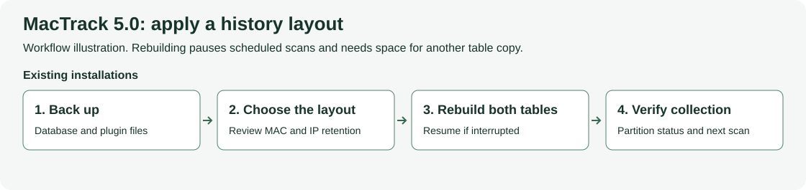

# MacTrack 5.0: clearer scan visibility and more manageable address history

Released November 17, 2026. [Download MacTrack 5.0](https://github.com/Cacti/plugin_mactrack/releases/tag/v5.0).

MacTrack 5.0 helps administrators see scan progress, exclude uplink sightings
and manage MAC and IP history with partition-based retention. Its dashboard and
Process Status page show current activity and skipped runs.

## Highlights

- **See what collection is doing.** The new Dashboard tab brings status cards
  together. Process Status reports scan phases, skipped runs, maintenance timings
  and table sizes, so an administrator has somewhere to start investigating a delay.
- **Manage MAC and IP history together.** Both history tables support partitioning
  by scan date. Retention drops whole expired partitions; existing installations
  can rebuild their tables to use daily, weekly or unpartitioned layouts.
- **Keep uplink and trunk sightings out of scans.** Set regular expressions for
  port names and aliases globally, per site or per device. The scanner reports
  how many MAC sightings it skipped.
- **Keep useful observations through interruptions.** Recovery fixes preserve
  completed scans during interrupted partition exchanges and retain staging data
  when recovery cannot finish. Address reports also retain Layer 2 sightings
  without current ARP data and identify older observations.
- **Read device and address results more clearly.** Collection fixes cover Cisco,
  Aruba and other scanners. Interface and authorization status pills, theme
  styles, and corrected MAC, IPv6 and vendor handling improve the reports used
  during day-to-day troubleshooting.

The release also includes security hardening across administrative actions,
imports, exports and device collection. See the [full changelog](../CHANGELOG.md)
for individual changes.

## Upgrade decision guide

| Check | What to plan |
| --- | --- |
| Runtime | Cacti 1.2.29+ and PHP 8.2+; check Cacti's own PHP requirements too. |
| Storage | MySQL 8.0+ or MariaDB with partition support for partitioned history; unpartitioned tables remain supported. |
| Existing tables | Updating files does not rebuild history. Choose a layout and run the partitioning utility when ready. |
| Rebuild impact | Scheduled scans and maintenance pause; MAC/IP results are incomplete. Allow space for another copy of each table and its indexes. Large histories can take hours. |
| Recovery | If a rebuild stops, rerun the same command to resume. Keep the original rebuild tables until recovery completes. |



### Upgrade and verify

1. Back up the database and plugin configuration/files together. Confirm the
   runtime requirements before replacing the plugin files in `plugins/mactrack`.
2. Complete the plugin upgrade in Cacti's Plugin Management. Check the Cacti log
   for upgrade errors before starting a history rebuild.
3. For an existing installation, review **Console > Settings > Mactrack > Port
   and IP Address Partition Size** and both retention settings. Prefer daily or
   weekly when planning a CLI rebuild; legacy hourly/per-scan layouts have
   different maintenance behavior described in the partitioning guide.
4. During a maintenance window, use **MacTrack Utilities > Configure Port and IP
   Address Partitioning**, or run this from the Cacti directory as the poller user:

   ```sh
   php plugins/mactrack/cli/upgrade_partitioning.php
   ```

5. Check **View Partition Status** for both history tables and **Process Status**
   for completion. Confirm the next scheduled scan finishes and fresh MAC/IP
   sightings appear before closing the maintenance window.

The utility changes only tables that do not match the selected scheme.
[Read the partitioning and interruption-recovery guide](../README.md#port-and-ip-history-partitioning)
for the exact layout options and progress messages.

### Behavior changes to review

- **MacAuth email:** configured report frequencies now take effect. Review
  recipients and frequency if reports previously never arrived.
- **Stored MAC values:** corrected binary SNMP decoding can change previously
  malformed values. Review historical matches and affected authorizations.
- **Device exports:** SNMP credentials are omitted. Imports preserve existing
  credentials; newly imported devices need credentials entered separately.

If rollback is needed, restore plugin files and the database from the same
pre-upgrade backup; do not assume an older plugin can use an upgraded schema.

## Contributors and change history

Thank you to the developers, translators, testers and reviewers who kept this
plugin moving forward. See the [linked contributor credits and selected commits](COMMITS_5.0.md).
Those links include the comparison, paginated history and original author records.
